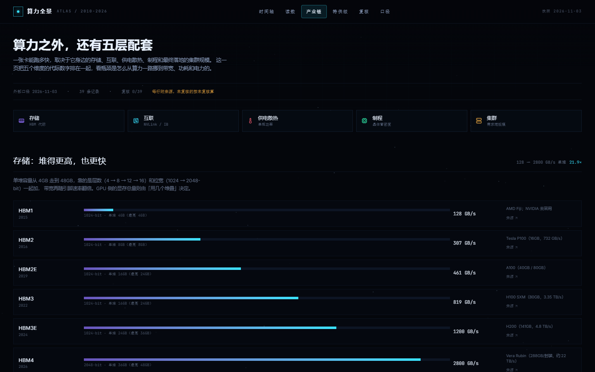

# 算力全景 · AI Compute Atlas

把三份分散的资料接成一条时间轴：**架构世代 → 芯片 / SKU → 整机 · 超节点 → 开源模型 → 技术突破**，再拆成四条读数（代际跃迁 / 单位算力价格 / 模型-显存共振 / 中国特供）、一份人工复核台账，外加一组**产业链配套维度**（HBM / 互联 / 供电散热 / 制程 / 集群）。

站点是**多页结构**：封面、时间轴、读数、产业链、特供版、复核、口径各占一页，页间用轻量转场连接；同一份快照另有构建期生成的纯 HTML 文本页供检索。

- 时间跨度：2010-2026
- 芯片：NVIDIA 154 款（10 代架构，含附录 Maxwell / Kepler / Fermi）+ 其他厂商 20 款
- 整机 / 超节点：15 台
- 开源模型：DeepSeek / GLM / Kimi 共 84 个发布节点、78 项技术突破（68 项来自三家自己的档案 + 10 项来自「模型年鉴」的基础技术）
- 中国特供：8 款，单独标注削减点




## 本地运行

```bash
npm install
npm run data     # 重新生成 src/data/atlas.json（需要三份原始资料，见下）
npm run dev      # http://localhost:5173
npm run build    # tsc --noEmit + vite build + 多页入口 → dist/
```

`build` 末尾的 `scripts/spa-routes.mjs` 会为 `/atlas`、`/charts`、`/export`、`/ledger`、`/about` 各生成一份 `dist/<route>/index.html`（各自的 title / description / canonical），再写一份 `dist/404.html` 兜底未知路径。本地想验证成品：`npm run preview`。

## 数据从哪来

`scripts/build_data.py` 是唯一入口，读三个来源后写出 `src/data/atlas.json`（页面只读这一份快照）：

| 来源 | 路径 | 取什么 |
| --- | --- | --- |
| NVIDIA 显卡历代产品全览 | `ATLAS_DOCX`（默认 `D:/Downloads/…docx`，**原件已不在本机**） | 10 张 Word 表 → 型号 / 类别 / CUDA / 显存 / FP32 / 首发时间 / 备注；解析结果快照在 `vendor/docx-products.json` |
| gpu-server-compare（已并入） | `vendor/gpu-server-compare/*.json` | 41 卡行情与性能索引、15 台整机、现货报价、来源台账 |
| model-chronicle（已并入） | `vendor/model-chronicle/*.ts` | 84 个发布节点、68 项突破（HF 官方 API 快照） |
| llm-release-timeline | `vendor/llm-timeline/releases.json` | Transformer / MoE / RLHF / Chinchilla / Mamba 等 10 个基础技术节点的日期与一手链接；同时提供「模型→技术」连线的证据（`scripts/tech_links.py` 生成 `data/llm-tech.json`） |
| 产业链维度 | `data/industry.json` | HBM 代际、NVLink / InfiniBand / 以太网 / CPO、整柜功率、制程节点、集群规模；每条带 `source` 与取数时间 |
| 二手补充 | `data/supplements/*.json` | 官方没公开或只到年份的零散字段（发布日、功耗、带宽等），一篇来源一个文件，字段级记来源与置信度 |

前三份是「原件 / 快照」，第四份 `data/industry.json` 是人工整理的公开口径，逐条附来源链接，和芯片表不是同一份文档，页面标注为「外部口径」。

三份来源都已快照进 `vendor/`：两个旧仓库的数据、以及 docx 解析后的产品行（`vendor/docx-products.json`）。docx 缺失时构建自动用快照，产物 md5 与原件解析一致；若哪天找回了 docx，用 `ATLAS_DOCX=` 指过去即可重新解析。

匹配规则（全部人工可复现，不做模糊猜测）：

- docx 型号 → `gpu-server-compare` 的 `id` 走显式别名表 `ALIASES`，一比一消费，已被占用的 id 不再复用；
- 抓不到的型号保持「仅文档」状态（空心圆），不补价格与性能；
- 整机没有独立发布日，按所用 GPU 平台首发日推断，档案里写「随某平台上市」，不冒充产品发布日；
- 多 GPU 板卡（`4×16GB 共 64GB`）同时记录「板卡总量」与「单卡容量」，时间轴与气泡用单卡容量。

没有一条编造或补值：模型卡/文档没写的字段是 `null`，页面显示「未公开 / —」。

## 技术节点与连线

`npm run tech`（= `python scripts/tech_links.py`）从 `vendor/llm-timeline/releases.json` 里挑出 10 个「首次公开一种方法」的记录，生成 `data/llm-tech.json`：

- `techs`：技术节点（Transformer / Sparse MoE / Instruct / RETRO / RLHF / Chinchilla / VLM / RWKV / Mamba / Diffusion LM），日期、机构、来源链接全部取自年表记录，脚本找不到对应记录会直接报错退出；
- `links`：模型 → 技术，外加一句证据（模型档案里提到该技术的原话），没有证据就不连；技术提出者本身由 `releaseId` 自动补一条。

时间轴上悬停模型节点会画出它用到的技术（技术节点也能反向连回模型），档案卡里列出这几项技术并可点开。年表来源的节点用虚线边框区分。

## 二手补充来源

很多字段官方从来没公布，或者只精确到年份（例如 PCIe 版的功耗、某张卡的具体发布日）。这类空白用行业汇总文章、拆解贴来补，但**补录和原始数据必须能分开追溯**，所以走独立目录：

```
data/supplements/<来源 id>.json     一篇来源一个文件，字段级记 value / confidence / quote
```

```jsonc
{
  "id": "zhihu-xxxxxxxx",
  "title": "文章标题",
  "url": "https://…",
  "author": "作者",
  "publishedAt": "2026-09-17",
  "retrievedAt": "2026-11-03",
  "level": "secondary",              // 二手：非官方规格
  "items": [
    { "id": "hop-h100pcie", "fields": {
        "tdpW": { "value": 400, "confidence": "high", "quote": "TDP：700W（SXM）、400W（PCIe）" }
    } }
  ],
  "conflicts": [                      // 文章与本地不一致的地方，人工判断后登记
    { "id": "hop-h100sxm", "field": "fp32", "local": 67, "article": 124,
      "resolution": "keep-local", "reason": "124 疑为稀疏口径" }
  ]
}
```

合并规则（`scripts/build_data.py`）：

- **只填空**：本地是 `null` / 空字符串才补；
- **日期只精细化**：`2022年` → `2022-03-22` 可以，换月换年不行（要换必须显式 `override: true` 并写 `reason`）；
- **冲突不覆盖**：文章和本地不一致时保留本地值，冲突进 `conflicts`，页面上不显示文章值；
- 每个补过的字段在 `atlas.json` 里留 `provenance[字段] = {src, conf, quote}`，档案卡里标角标：**青色「官」= 厂商 datasheet 一手规格，紫色「补」= 二手来源**，底部列出全部来源。
- 来源带 `level`（`primary` / `secondary`）与 `priority`（数字小的先合并）。厂商资料优先：同一字段厂商发布过，就不要用二级来源。

```bash
npm run supplement -- list        # 所有来源：生效字段数 / 冲突数
npm run supplement -- check       # 校验结构 + 预演合并（缺 quote、字段名非法都会报）
npm run data                      # 重新合并进快照
```

`check` 会拒绝：未知 id、不在白名单的字段、`confidence` 非 high/medium/low、以及**缺 `quote`** —— 没有原文出处的一律不收。

## 复核台账

数据全部是手工抓取整理的，没有自动校验，准确率无法完全保证。所以另有一份独立的复核台账 `data/reviews.json`：每条记录记「被人工核对过几次、最近一次是哪天」。构建时由 `scripts/build_data.py` 合入 `atlas.json` 的 `review` 字段；**台账里没有的条目就是 `count = 0`，页面明写「未复核」**，不糊弄成「已验证」。

```json
{
  "items": {
    "blk-rtx5090": {
      "count": 2,
      "lastReviewedAt": "2026-11-02",
      "by": "weidows",
      "note": "对照规格页核对显存 32GB GDDR7 与 575W 功耗"
    }
  }
}
```

- 台账与快照分离，重跑 `npm run data` 不会冲掉人工记录；台账里的 id 在快照中消失时构建会告警。
- 记账走 CLI（id 必须在 `atlas.json` 里存在，避免手滑写出幽灵条目）：

```bash
npm run review -- stats                                  # 覆盖率汇总（按类型）
npm run review -- list --unreviewed                      # 还没复核的条目
npm run review -- mark blk-rtx5090 --note "对照规格页核对显存/功耗"
npm run review -- mark --arch Blackwell --tier datacenter --force   # 整批记一次
npm run review -- undo blk-rtx5090                       # 撤销一次（记错了）
npm run data && npm run build                            # 重新生成快照与静态页
```

- 展示：节点档案顶部一条 `已复核 2 次 · 最近 2026-11-02`（0 次是橙色的「未复核 · 单次抓取，尚未二次核对」）；页脚与面板底栏显示全站覆盖率；静态站的 `/review/` 逐条列出次数、日期、备注，未复核的排最前，可以直接当核对清单用。
- `atlas.json` 每条记录带 `review.count` / `review.lastReviewedAt` / `review.by` / `review.note`，汇总在 `reviews.stats`（含 `byKind` 分项），外部对拍时同样能看到可信度。

复核只记录「有人按来源重新核对过」，不等于所有字段都被独立验证过——来源口径本身（估算值、稀疏值、板卡总量）仍需按项目页脚的口径说明理解。

## 结构

```
src/
  data/atlas.json        构建产物（唯一数据源）
  lib/
    atlas.ts             类型、时间标度、派生序列（代际峰值 / 单位算力价格 / 年度共振）
    router.tsx           极简 pushState 路由（Link / useRoute / usePageMeta）
  pages/
    Cover.tsx            封面：五层结构、章节卡、复核进展
    Timeline.tsx         全景时间轴 + 节点档案
    Charts.tsx           三条读数：代际 / 单价 / 共振
    Stack.tsx            产业链：HBM / 互联 / 供电散热 / 制程 / 集群
    Export.tsx           中国特供：8 款与削减点
    Ledger.tsx           复核台账：覆盖率、筛选、逐条记录
    About.tsx            三份来源、字段口径、文本版入口
  components/
    Shell.tsx            站点外壳：导航 / 移动端菜单 / 转场扫描线 / 页脚
    motion.tsx           Reveal / CountUp / SpotlightCard / 页面转场变体
    Atlas.tsx            主时间轴：7 条带、标签避让、缩放、全览条、筛选
    DetailPanel.tsx      节点档案（硬件 / 整机 / 模型 / 突破四种形态）+ 复核状态
    Analytics.tsx        三个图块 + SectionHead（被 Charts 页复用）
    Starfield.tsx
data/
  reviews.json           人工复核台账（次数 / 最近复核时间 / 备注），由构建合入快照
  supplements/           二手补充来源（一篇一个 JSON，字段级 quote + 置信度）
  industry.json          产业链五维度的公开口径（每条带来源），构建时合入 atlas.json
scripts/
  build_data.py          数据构建（可重跑，合并复核台账）
  review.mjs             复核台账 CLI：stats / list / mark / undo / reset
  supplement.mjs         补录来源校验 / 预演合并（list / check）
  seo.mjs                静态文本页 + sitemap/robots（prebuild 执行）
  spa-routes.mjs         多页入口 / 404 兜底（build 末尾执行）
  pages.mjs              六个章节的标题、h1、溢出、控制台错误 + 截图
  mobile.mjs             390 / 768 / 1440 三档溢出与移动端菜单
  verify.mjs             CDP 截图 + 控制台错误 + 时间轴几何检测
  probe.mjs              标签碰撞 / 分层节点计数 / 分区截图
```

## 页面结构

| 路径 | 章节 | 内容 |
| --- | --- | --- |
| `/` | 封面 | 一句话定位、五层结构、章节入口、复核进展 |
| `/atlas` | 时间轴 | 五层内容一条横轴，整页一屏（1440×900 无需竖滚）；拖拽或 Shift+滚轮横向平移，点节点开档案 |
| `/charts` | 读数 | 代际跃迁、单位算力价格、模型与显存共振 |
| `/stack` | 产业链 | 存储 / 互联 / 供电散热 / 制程 / 集群五个维度，每条带来源 |
| `/export` | 特供版 | 8 款中国特供与其削减点 |
| `/ledger` | 复核 | 每条的核对次数、最近复核时间、备注与筛选 |
| `/about` | 口径 | 三份来源、字段定义、可信度与文本版入口 |

路由是手写的 pushState（`src/lib/router.tsx`），不引 router 依赖：`Link` 保留真实 href（新窗口 / 爬虫可用），左键单击走无刷新跳转；`build` 后每个路径都有实体 HTML，深链返回 200。转场由 `AnimatePresence` 统一进出场，只用 transform / opacity，且全部走 `useReducedMotion` 降级。

时间轴页悬停模型节点时，会从它画虚线连到它用到的技术突破点（技术节点也会反向连回所有用到它的模型）；连线只在模型档案自己写了「用了它」时才画，档案卡里同时列出这几项技术。年表来源的 10 个基础技术节点用虚线边框区分。

页脚只在封面出现，各章节以内容收尾。时间轴页按「工具」而非「文章」设计：条带高度压到 680px，整页刚好一屏；横向平移支持鼠标拖拽、Shift+滚轮、触控板横划，页面本身不需要竖滚时普通滚轮也直接横拉（拖拽超过 4px 会吞掉那次 click，避免误开档案）。

## 怎么读

- 每一列是一个时间切片：上面是当年出货的芯片与整机，下面是同年开源的模型；
- 圆点大小 = 单卡显存，实心 = 有行情/性能数据，空心虚线 = 仅文档收录，⚑ = 中国特供；
- 点任意节点 → 右侧档案，附「同期开源模型 / 发布时可用算力」跨层链接；档案顶部标出这条的复核次数与最近复核时间，未复核的会明说；
- 底部全览条：青柱是芯片密度、紫柱是模型密度，点击跳转年份。

## SEO / 可检索性

主页面是 CSR（React 渲染），所以另做了一层**构建期生成的静态内容页**，让不跑 JS 的爬虫与检索都能拿到正文：

| URL | 内容 |
| --- | --- |
| `/atlas` `/charts` `/stack` `/export` `/ledger` `/about` | 交互章节，各自一份实体 HTML（独立 title / description / canonical，返回 200） |
| `/stack/` | 产业链五维度的文本表：HBM 代际、互联规格、整柜功率、制程节点、集群规模 |
| `/data/` | 完整数据总表：154 款产品 / 84 个模型 / 15 台整机，可 Ctrl+F |
| `/generations/<世代>/` | 10 个世代各一页（blackwell、hopper、ada-lovelace…） |
| `/models/<实验室>/` | DeepSeek / GLM / Kimi 三页发布年表与突破 |
| `/china/` | 8 款中国特供与被削规格 |
| `/review/` | 复核台账：390 条逐条列复核次数、最近复核时间与备注，未复核的排最前 |
| `/sitemap.xml` · `/robots.txt` | 23 条 URL + 抓取声明 |
| `/data/atlas.json` | 机器可读快照（供引用、对拍、AI 检索） |
| `/og.png` | 1200×630 社交分享卡 |

- 生成脚本 `scripts/seo.mjs`（prebuild）与 `scripts/spa-routes.mjs`（build 末尾），产物不进版本库（`.gitignore`）。
- `index.html` 带 canonical、og/twitter、`WebSite + Dataset + TechArticle` JSON-LD；静态页各自带 `CollectionPage / ItemList / Dataset` 与 canonical。
- 页面之间互链：页脚 → 数据总表 / 中国特供 / 分世代档案，数据页 → 三个实验室。

站长后台还需手动做一次（不在代码里）：

1. Google Search Console / Bing Webmaster 添加 `blog.weidows.tech`，提交 `https://ai-compute-atlas.weidows.tech/sitemap.xml`；
2. 根域 `robots.txt` 归博客仓（`Blog-private/source/robots.txt`），加一行 `Sitemap: https://ai-compute-atlas.weidows.tech/sitemap.xml`；
3. 百度搜索资源平台对 GitHub Pages 的抓取不稳定，若重视百度，需要镜像到国内可访问的域名。

## 部署

线上地址：<https://ai-compute-atlas.weidows.tech/>（GitHub Pages 项目站 + 独立子域）

GitHub Pages：`.github/workflows/deploy.yml` 在 `main` 推送时以 `VITE_BASE=/` 构建（独立子域伺服在域名根），产物推到 `gh-pages` 之外的 Pages artifact。

多页路由：`spa-routes.mjs` 为每个章节生成 `dist/<route>/index.html`，深链直接 200；`dist/404.html` 兜底未收录路径。新增章节时，路由表在 `src/lib/router.tsx`（`ROUTES`），静态入口在 `scripts/spa-routes.mjs`（`ROUTES`），两处同步加一行。

自定义域：`ai-compute-atlas.weidows.tech`（Cloudflare CNAME → `weidows.github.io`，灰云不开代理）；换域时改 `index.html` 里的绝对 URL 与 `scripts/seo.mjs` 的 `SITE_URL` 默认值，再 `npm run build`。

## 口径与边界

- FP32 标「约」的为按「CUDA 核心 × 2 × Boost」估算；数据中心卡的张量算力在备注中按稀疏值记录（约为稠密 2 倍）。
- 不同架构的浮点 / 张量指标不可直接跨代相比。
- 价格为中国区参考价与卖方报价快照（2026-09-29），含渠道溢价；整机单卡折算是机械除法。
- 模型下载量是 Hugging Face 滚动 30 天口径。
- 本项目只做资料整理与可视化，不构成采购或投资建议。
