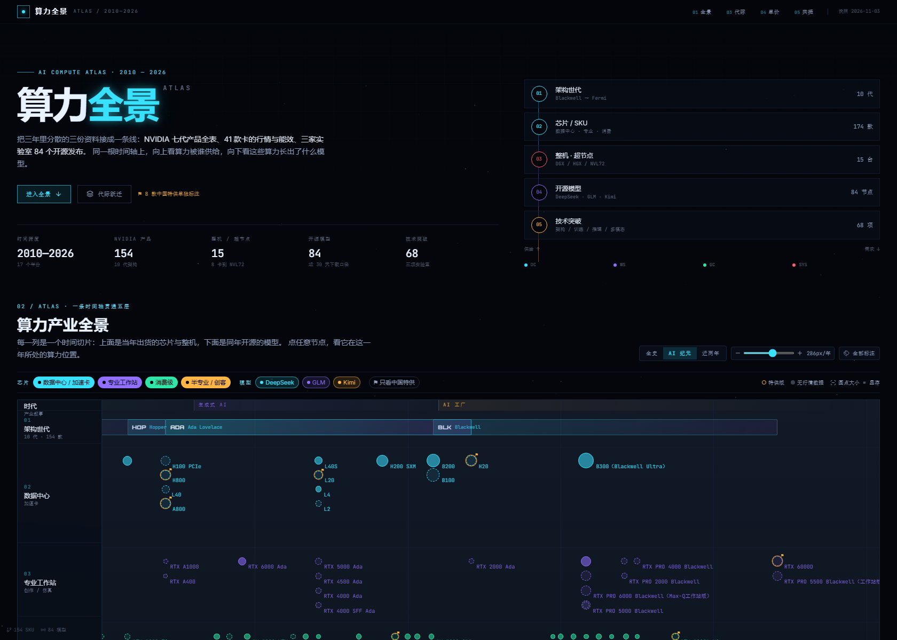
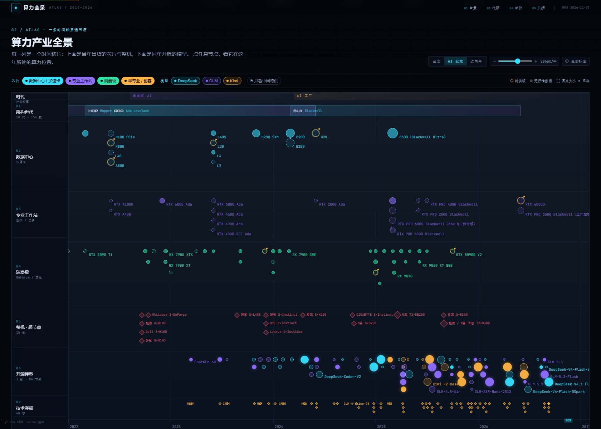
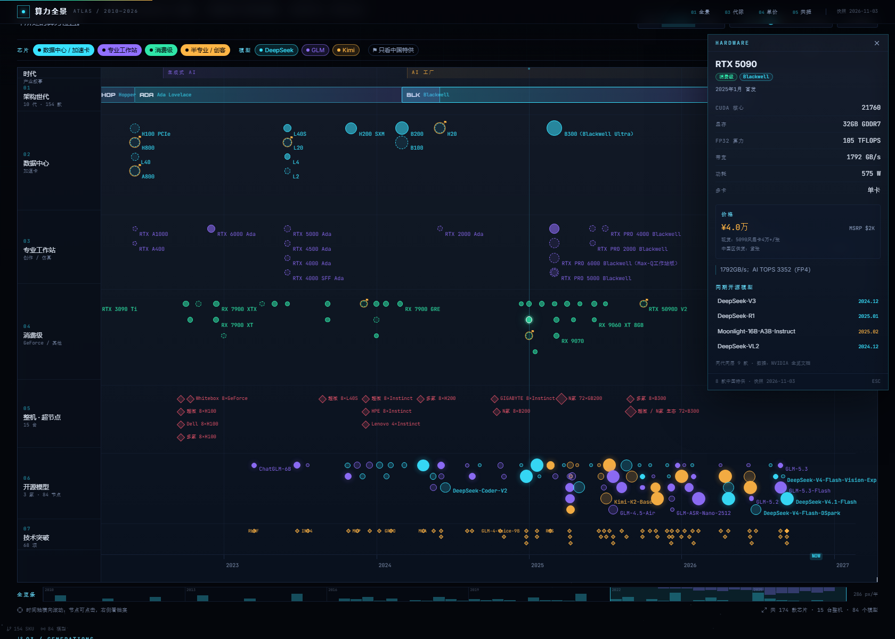

# 算力全景 · AI Compute Atlas

把三份分散的资料接成一条时间轴：**架构世代 → 芯片 / SKU → 整机 · 超节点 → 开源模型 → 技术突破**，向下再拆成三张读数图（代际跃迁 / 单位算力价格 / 模型-显存共振）与一张中国特供表。

- 时间跨度：2010—2026
- 芯片：NVIDIA 154 款（10 代架构，含附录 Maxwell / Kepler / Fermi）+ 其他厂商 20 款
- 整机 / 超节点：15 台
- 开源模型：DeepSeek / GLM / Kimi 共 84 个发布节点、68 项技术突破
- 中国特供：8 款，单独标注削减点





## 本地运行

```bash
npm install
npm run data     # 重新生成 src/data/atlas.json（需要三份原始资料，见下）
npm run dev      # http://localhost:5173
npm run build    # tsc --noEmit + vite build → dist/
```

## 数据从哪来

`scripts/build_data.py` 是唯一入口，读三个来源后写出 `src/data/atlas.json`（页面只读这一份快照）：

| 来源 | 路径 | 取什么 |
| --- | --- | --- |
| NVIDIA 显卡历代产品全览 | `D:/Downloads/NVIDIA显卡历代产品全览.docx` | 10 张 Word 表 → 型号 / 类别 / CUDA / 显存 / FP32 / 首发时间 / 备注 |
| gpu-server-compare | `../gpu-server-compare/data/*.json` | 41 卡行情与性能索引、15 台整机、现货报价、来源台账 |
| model-chronicle | `../model-chronicle/src/data/*.ts` | 84 个发布节点、68 项突破（HF 官方 API 快照） |

docx 路径可用环境变量覆盖：`ATLAS_DOCX=... python scripts/build_data.py`。gpu-server-compare 与 model-chronicle 按相对路径读取，需与本仓库同级。

匹配规则（全部人工可复现，不做模糊猜测）：

- docx 型号 → `gpu-server-compare` 的 `id` 走显式别名表 `ALIASES`，一比一消费，已被占用的 id 不再复用；
- 抓不到的型号保持「仅文档」状态（空心圆），不补价格与性能；
- 整机没有独立发布日，按所用 GPU 平台首发日推断，档案里写「随某平台上市」，不冒充产品发布日；
- 多 GPU 板卡（`4×16GB 共 64GB`）同时记录「板卡总量」与「单卡容量」，时间轴与气泡用单卡容量。

没有一条编造或补值：模型卡/文档没写的字段是 `null`，页面显示「未公开 / —」。

## 结构

```
src/
  data/atlas.json        构建产物（唯一数据源）
  lib/atlas.ts           类型、时间标度、派生序列（代际峰值 / 单位算力价格 / 年度共振）
  components/
    Atlas.tsx            主时间轴：7 条带、标签避让、缩放、全览条、筛选
    DetailPanel.tsx      节点档案（硬件 / 整机 / 模型 / 突破四种形态）
    Analytics.tsx        四块读数：代际 / 单价 / 共振 / 中国特供
    Hero.tsx  Footer.tsx  Starfield.tsx
scripts/
  build_data.py          数据构建（可重跑）
  verify.mjs             CDP 截图 + 控制台错误 + 溢出检测
  probe.mjs              标签碰撞 / 分层节点计数 / 分区截图
  mobile.mjs             390 / 768 / 1440 三档溢出与文案检查
```

## 怎么读

- 每一列是一个时间切片：上面是当年出货的芯片与整机，下面是同年开源的模型；
- 圆点大小 = 单卡显存，实心 = 有行情/性能数据，空心虚线 = 仅文档收录，⚑ = 中国特供；
- 点任意节点 → 右侧档案，附「同期开源模型 / 发布时可用算力」跨层链接；
- 底部全览条：青柱是芯片密度、紫柱是模型密度，点击跳转年份。

## SEO / 可检索性

主页面是 CSR（React 渲染），所以另做了一层**构建期生成的静态内容页**，让不跑 JS 的爬虫与检索都能拿到正文：

| URL | 内容 |
| --- | --- |
| `/data/` | 完整数据总表：154 款产品 / 84 个模型 / 15 台整机，可 Ctrl+F |
| `/generations/<世代>/` | 10 个世代各一页（blackwell、hopper、ada-lovelace…） |
| `/models/<实验室>/` | DeepSeek / GLM / Kimi 三页发布年表与突破 |
| `/china/` | 8 款中国特供与被削规格 |
| `/sitemap.xml` · `/robots.txt` | 16 条 URL + 抓取声明 |
| `/data/atlas.json` | 机器可读快照（供引用、对拍、AI 检索） |
| `/og.png` | 1200×630 社交分享卡 |

- 生成脚本 `scripts/seo.mjs`，由 `prebuild` 自动执行，产物不进版本库（`.gitignore`）。
- `index.html` 带 canonical、og/twitter、`WebSite + Dataset + TechArticle` JSON-LD；静态页各自带 `CollectionPage / ItemList / Dataset` 与 canonical。
- 页面之间互链：页脚 → 数据总表 / 中国特供 / 分世代档案，数据页 → 三个实验室。

站长后台还需手动做一次（不在代码里）：

1. Google Search Console / Bing Webmaster 添加 `blog.weidows.tech`，提交 `https://blog.weidows.tech/ai-compute-atlas/sitemap.xml`；
2. 根域 `robots.txt` 归博客仓（`Blog-private/source/robots.txt`），加一行 `Sitemap: https://blog.weidows.tech/ai-compute-atlas/sitemap.xml`；
3. 百度搜索资源平台对 GitHub Pages 的抓取不稳定，若重视百度，需要镜像到国内可访问的域名。

## 部署

GitHub Pages：`.github/workflows/deploy.yml` 在 `main` 推送时以 `VITE_BASE=/ai-compute-atlas/` 构建。

自定义域（可选）：在仓库 Settings → Pages 写入域名，并把 `public/CNAME` 指向它，同时把 `VITE_BASE` 改成 `/`。

## 口径与边界

- FP32 标「约」的为按「CUDA 核心 × 2 × Boost」估算；数据中心卡的张量算力在备注中按稀疏值记录（约为稠密 2 倍）。
- 不同架构的浮点 / 张量指标不可直接跨代相比。
- 价格为中国区参考价与卖方报价快照（2026-09-29），含渠道溢价；整机单卡折算是机械除法。
- 模型下载量是 Hugging Face 滚动 30 天口径。
- 本项目只做资料整理与可视化，不构成采购或投资建议。
